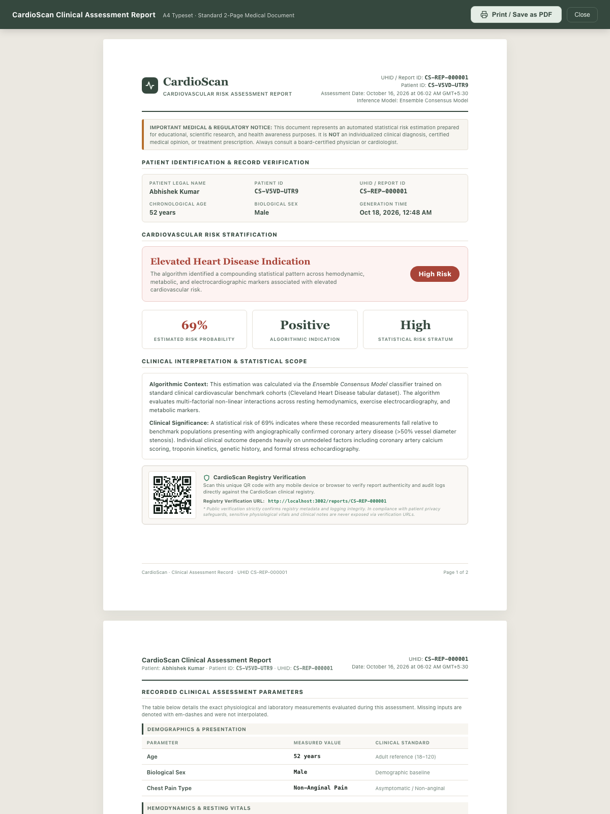
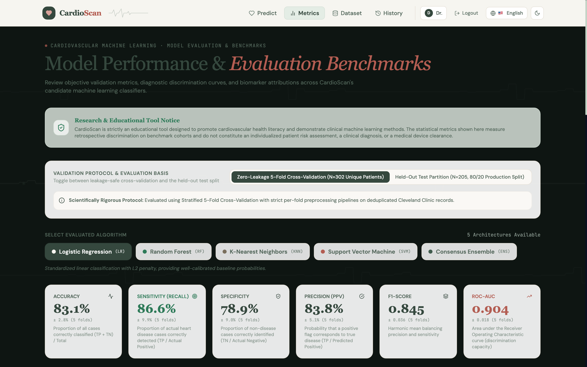
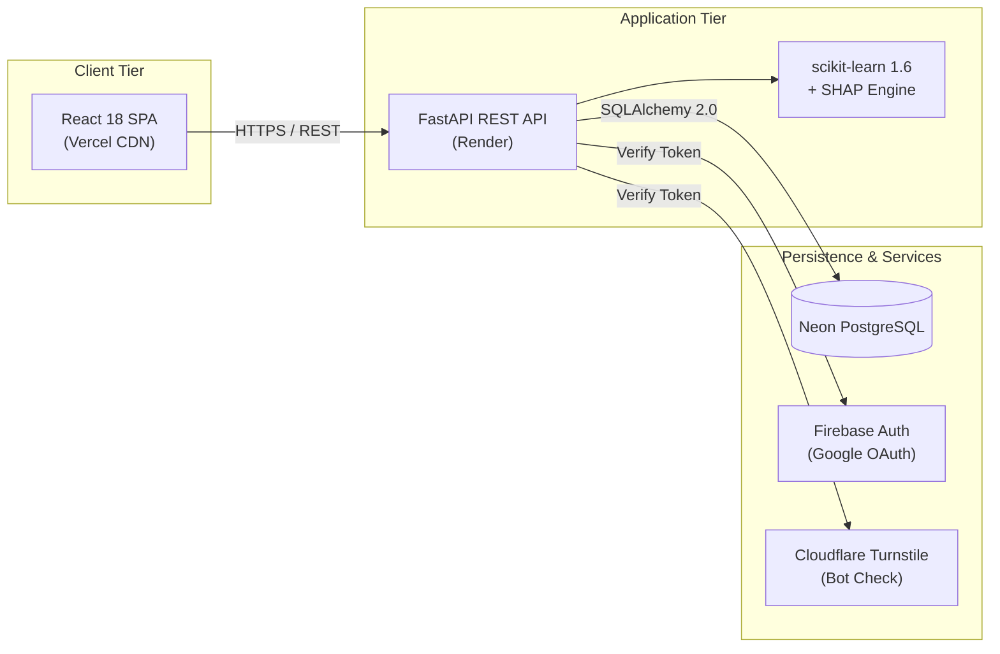

# CardioScan

An explainable machine learning platform for cardiovascular risk exploration, multi-model evaluation, and verifiable clinical reporting.

[](https://react.dev)
[](https://fastapi.tiangolo.com)
[](https://python.org)
[](https://scikit-learn.org)
[](https://neon.tech)
[](LICENSE)

---

### Access & Endpoints

| Resource | Link | Description |
| :--- | :--- | :--- |
| **Production App** | [cardio-scan-lac.vercel.app](https://cardio-scan-lac.vercel.app/) | Live single-page application on Vercel Edge CDN |
| **Direct Short Link** | [spoo.me/cardioscan](https://spoo.me/cardioscan) | Verified short redirect with zero ad interstitials |
| **API Documentation** | [cardioscan-api-1gbm.onrender.com/docs](https://cardioscan-api-1gbm.onrender.com/docs) | Interactive Swagger UI for FastAPI backend endpoints |
| **Repository** | [github.com/Abhis1905/CardioScan](https://github.com/Abhis1905/CardioScan) | Source code, test suites, and deployment assets |

---

## Overview

CardioScan evaluates 13 standard clinical variables against five trained machine-learning architectures to demonstrate how multi-factorial hemodynamic and metabolic markers compound into cardiovascular risk estimates. The system emphasizes Explainable AI (XAI) through individual feature attributions, real-time parameter sensitivity controls, and client-side verifiable clinical report generation.

Built as an academic research and educational prototype, CardioScan is designed to explore production ML engineering, model interpretability, and cross-cultural user interface design in health informatics.

---

## Product Showcase

<p align="center">
  
  <br/>
  <em>Client-side verifiable PDF Clinical Assessment Report featuring immutable patient identifiers, risk stratification tiers, and embedded QR code resolving to live registry validation routes.</em>
</p>

<p align="center">
  
  <br/>
  <em>Model evaluation suite displaying discrimination curves and zero-leakage 5-fold cross-validation metrics across all five candidate algorithms on deduplicated clinical records.</em>
</p>

---

## Key Capabilities

- **Multi-Model Risk Estimation:** Evaluates patient biomarker sets across Random Forest (100 trees), Logistic Regression (L2 regularized baseline), K-Nearest Neighbors, Support Vector Machine (RBF kernel with Platt scaling), and a majority-voting Consensus Ensemble.
- **SHAP Prediction Explainability:** Decomposes risk predictions into Shapley Additive Explanations (TreeSHAP and LinearSHAP), quantifying the precise directional impact and magnitude each biomarker contributes relative to baseline population expectations.
- **What-If Sensitivity Simulation:** Real-time multi-variable sensitivity controls illustrating how targeted physiological adjustments (e.g., blood pressure control or exercise ST improvement) shift model risk probabilities.
- **Verifiable Clinical Reports:** Generates vector PDF documents with deterministic Report IDs (`CR-XXXX-XXXX`), hospital-format Patient IDs (`CS-XXXX-XXXX`), and high-density QR verification badges linking to live `/reports/:reportId` audit endpoints.
- **Universal Internationalization & RTL:** Complete localization across 8 languages (English, Spanish, French, German, Hindi, Arabic, Chinese, Portuguese), including a fully mirrored bidirectional layout for Arabic (`dir="rtl"`).
- **Design System Harmonization:** Verified neutral charcoal dark mode (`#17191B` base, `#202326` surfaces, `#373C40` borders, `#F2F3F3` typography) with zero pre-render flashing, alongside a preserved warm-cream light mode (`#F7F5F0`).
- **Dual Authentication & Security:** Email and salted bcrypt password authentication alongside Firebase Google OAuth sign-in, guarded by server-verified Cloudflare Turnstile bot protection.
- **Platform Telemetry & Auditing:** Administrative governance console tracking real-time model throughput, dataset deduplication audit metrics, and database operational health.

---

## Architecture



---

## Technology Stack

| Layer | Core Technologies | Responsibility |
| :--- | :--- | :--- |
| **Frontend** | React 18, Tailwind CSS, Framer Motion | Single-page application, fluid transitions, and responsive layout |
| **Visuals & Reports** | Recharts, Lucide Icons, jsPDF, qrcode | Dynamic telemetry gauges, attribution charts, and verifiable PDF export |
| **Internationalization** | i18next, react-i18next | Multi-locale translation catalogs with bidirectional Arabic RTL support |
| **Backend API** | FastAPI 0.111, Uvicorn, Pydantic v2 | High-throughput asynchronous REST API with automatic OpenAPI generation |
| **Machine Learning** | scikit-learn 1.6, SHAP, NumPy, Pandas | Model training pipelines, probability calibration, and feature attribution |
| **Database & ORM** | PostgreSQL (Neon), SQLAlchemy 2.0 | Relational database persistence and transactional ORM sessions |
| **Schema Migrations** | Alembic 1.13 | Reversible database schema version control |
| **Authentication** | Firebase Admin SDK, PyJWT, passlib (bcrypt) | Federated OAuth validation, JWT session handling, and password hashing |
| **Bot Mitigation** | Cloudflare Turnstile | Server-side verified invisible challenge preventing automated abuse |
| **Infrastructure** | Vercel (Frontend), Render (API) | Automated continuous integration and containerized cloud deployment |

---

## Local Development

### Prerequisites
- Python 3.10 or higher
- Node.js 18 or higher with `npm`
- Git

### Backend Setup
```bash
cd backend

# Create and activate virtual environment
python3 -m venv venv
source venv/bin/activate  # Windows: venv\Scripts\activate

# Install dependencies and prepare local database
pip install -r requirements.txt
cp .env.example .env
alembic upgrade head

# Start API server
uvicorn app.main:app --host 127.0.0.1 --port 8000 --reload
```
API endpoints and interactive Swagger documentation will be available at `http://127.0.0.1:8000/docs`.

### Frontend Setup
In a new terminal:
```bash
cd frontend

# Install dependencies and configure environment
npm install --legacy-peer-deps
cp .env.example .env.local

# Start development server
npm start
```
The web application will open at `http://localhost:3000`.

### Running Verification Suites
- **Backend Tests:** `pytest tests/ -v` (runs endpoint contracts, safety assertions, and auth tests)
- **Frontend Tests:** `npm test -- --watchAll=false` (runs report generation, QR validation, and XSS sanitization tests)

---

## Limitations & Scientific Boundaries

CardioScan is strictly an academic demonstration and healthcare informatics research prototype.
- **Non-Diagnostic Tool:** Computational estimates represent statistical pattern matching against training cohort distributions. They do not constitute an individualized medical diagnosis, clinical opinion, or treatment plan.
- **Dataset Provenance:** Models are trained on the historic 1988 Cleveland Clinic Foundation benchmark cohort (UCI Machine Learning Repository, 302 unique observations after duplicate removal). The cohort reflects a specific hospital-referral population with a high prevalence of coronary artery disease; statistical outputs cannot be generalized to general healthy populations.
- **Missing Contemporary Biomarkers:** Standard clinical calculators (such as ASCVD or Framingham) rely on high-sensitivity troponin, hs-CRP, smoking pack-years, and lipid fractions (HDL/LDL) which are not present in the 13-parameter tabular format.
- **Medical Consultation:** Never delay or disregard professional clinical evaluation based on outputs from this tool.

---

## Author & License

- **Author:** Abhishek Kumar ([@Abhis1905](https://github.com/Abhis1905))
- **License:** Released under the [MIT License](LICENSE).
