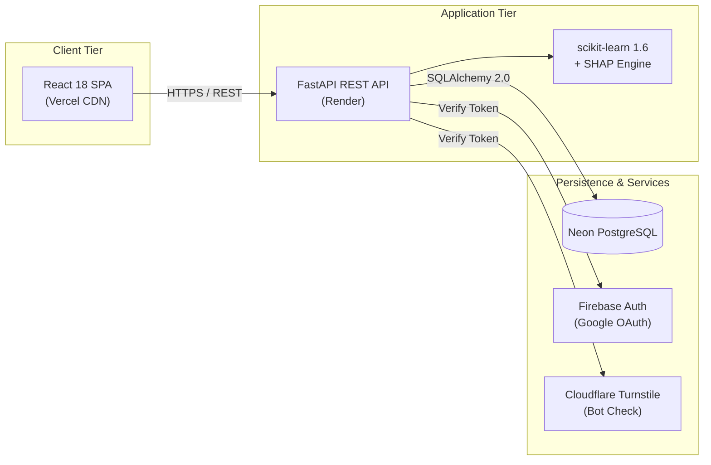

# CardioScan

An open-source cardiovascular risk exploration and machine learning explainability platform.

[](https://react.dev)
[](https://fastapi.tiangolo.com)
[](https://python.org)
[](https://scikit-learn.org)
[](https://neon.tech)
[](LICENSE)

---

## Links

- **Live Application:** [cardio-scan-lac.vercel.app](https://cardio-scan-lac.vercel.app/)
- **Short Link:** [spoo.me/cardioscan](https://spoo.me/cardioscan)
- **Source Code:** [github.com/Abhis1905/CardioScan](https://github.com/Abhis1905/CardioScan)
- **API Documentation:** [cardioscan-api-1gbm.onrender.com/docs](https://cardioscan-api-1gbm.onrender.com/docs)

---

## Overview

CardioScan is a full-stack educational and research prototype that evaluates cardiovascular disease risk patterns using standard clinical biomarkers. It runs multiple supervised machine learning models, provides feature-level SHAP (Shapley Additive Explanations) attributions, and generates verifiable PDF reports with embedded QR codes. The project is designed to demonstrate explainable AI (XAI) and production engineering in healthcare informatics.

---

## Key Capabilities

- **Multi-Model Inference:** Risk evaluations across Random Forest, Logistic Regression, K-Nearest Neighbors, Support Vector Machine (RBF kernel), and a majority-voting Consensus Ensemble.
- **Explainable AI (SHAP):** Marginal probability attribution charts breaking down how individual patient variables influence model estimates.
- **Interactive Sensitivity Simulation:** Real-time "What-If" controls to observe how parameter adjustments affect compound risk scores.
- **Verifiable Clinical Reports:** Client-side PDF generation with deterministic Report IDs (`CR-XXXX-XXXX`) and scannable QR verification badges resolving to live validation routes.
- **Internationalization (i18n):** Full support for 8 languages (English, Spanish, French, German, Hindi, Arabic, Chinese, Portuguese) with bidirectional Right-to-Left (RTL) layout for Arabic.
- **Theme Harmonization:** Charcoal dark mode (`#17191B` / `#202326`) and preserved light mode with zero pre-render flashing.
- **Dual Authentication & Security:** Email/password authentication (salted bcrypt) and Firebase Google OAuth sign-in, protected by Cloudflare Turnstile bot verification.
- **Platform Telemetry:** Role-based administrative dashboard for real-time model usage metrics, dataset integrity auditing, and user management.

---

## Technology Stack

| Domain | Technology | Purpose |
| :--- | :--- | :--- |
| **Frontend** | React 18, Tailwind CSS, Framer Motion | Single-page application, responsive layout, and transitions |
| **Data & Visuals** | Recharts, Lucide Icons, jsPDF, qrcode | Charts, telemetry gauges, and verifiable PDF exports |
| **Internationalization** | i18next, react-i18next | Multi-language translation dictionaries with RTL support |
| **Backend** | FastAPI, Uvicorn, Pydantic v2 | High-throughput asynchronous REST API |
| **Machine Learning** | scikit-learn 1.6, SHAP, NumPy, Pandas | Supervised classifiers, probability calibration, and attribution |
| **Database & ORM** | PostgreSQL (Neon), SQLAlchemy 2.0 | Persistent relational storage and ORM modeling |
| **Migrations** | Alembic 1.13 | Reversible database schema version control |
| **Authentication** | Firebase Admin SDK, PyJWT, passlib (bcrypt) | Federated OAuth, JWT session management, and credential hashing |
| **Bot Mitigation** | Cloudflare Turnstile | Server-side verified invisible bot protection |
| **Infrastructure** | Vercel (Frontend CDN), Render (Backend Service) | Automated continuous deployment pipelines |

---

## Architecture



---

## Local Development

### Prerequisites
- Python 3.10+
- Node.js 18+
- Git

### Backend Setup
```bash
cd backend
python3 -m venv venv
source venv/bin/activate  # On Windows: venv\Scripts\activate
pip install -r requirements.txt
cp .env.example .env
alembic upgrade head
uvicorn app.main:app --host 127.0.0.1 --port 8000 --reload
```
The interactive API documentation is available at `http://127.0.0.1:8000/docs`.

### Frontend Setup
```bash
cd frontend
npm install --legacy-peer-deps
cp .env.example .env.local
npm start
```
The web application will open at `http://localhost:3000`.

### Running Tests
- **Backend:** `pytest tests/` (from `backend/`)
- **Frontend:** `npm test -- --watchAll=false` (from `frontend/`)

---

## Limitations

CardioScan is an educational prototype and research exploration tool.
- **Not a Diagnostic Device:** Model outputs represent statistical associations learned from training data and must not be interpreted as an individual clinical diagnosis or medical recommendation.
- **Cohort Demographics:** The models are trained on the historic 1988 Cleveland Clinic Foundation benchmark cohort (UCI Machine Learning Repository, 302 unique observations after exact-duplicate removal). Findings reflect a specific hospital-referral population and cannot be generalized to contemporary unselected populations.
- **Consultation Required:** Always consult a licensed healthcare professional for clinical evaluations and cardiovascular health decisions.

---

## Author & License

- **Author:** Abhishek Kumar ([@Abhis1905](https://github.com/Abhis1905))
- **License:** Released under the [MIT License](LICENSE).
